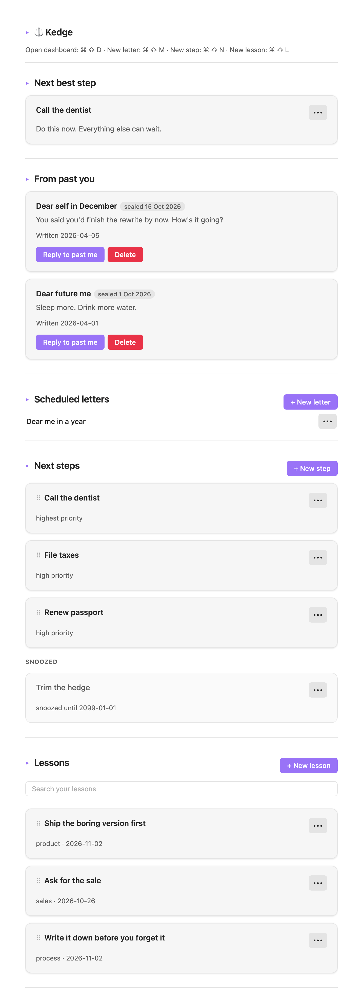

# ⚓ Kedge

> /kĕj/ _(noun)_
>
> A small [anchor](https://duckduckgo.com/?q=anchor+definition\&ia=definition) used for warping a vessel; also called a kedge anchor.

I wrote this Obsidian plugin to help keep myself on track. Will it work? I don’t know yet, going to run it for a few weeks to see what happens.

It shows me the next step I should take. These are like a to-do list, but with some order of priority, and you can drag & drop to sort them.

I can write letters to my future self. Sometimes I come up with ideas but I won’t remember them a week from now, or even a month from now. So I write it today, seal it for a future date, and will get reminded later.

And I can save lessons for future reference. Things I learned that work well, or don’t work well, or whatever it is I need to remind myself in the future.

By organizing into next steps, future letters, and lessons, I think I captured how I think and process information. It’s less about the feature, and more about the User Experience meeting my brain’s operating system.

## Install Kedge

**From the community store.** Settings → Community plugins → Browse, search for Kedge. That's the normal path once it is listed; while the submission is in review, use one of the two below.

**BRAT, which updates itself.** Install [BRAT](https://github.com/TfTHacker/obsidian42-brat), then *Add beta plugin* → `assaf/kedge`. Works on desktop and phone; each release shows up as an update.

**Copy a release.** Grab `main.js`, `manifest.json` and `styles.css` from the [latest release](https://github.com/assaf/kedge/releases/latest) and put them in `<vault>/.obsidian/plugins/kedge/`.

Building it yourself is `pnpm install && pnpm build`, then copy the same three files.

Either way, enable it in Settings → Community plugins → Kedge.

Users can assign their own hotkeys in Obsidian Settings.

- 2026-11-06: 1.0.6. priorities are three soft pastels (high, medium, low) and old five-level notes fold into the nearest three.
- 2026-11-05: 1.0.4. no default hotkeys: the four ⌘⇧D/M/N/L bindings are gone, the official lint rule is back on, and the dashboard header stops printing shortcuts. commands still exist; assign your own in Obsidian Settings.
- 2026-11-04: 1.0.1. no console output ships: the three error paths still surface a notice, they just stop writing to devtools. console stays a development tool.
- 2026-11-04: 1.0.0. an mit license, a versions.json, and an install section that knows about the community store. nothing about the plugin itself changed.
- 2026-11-03: next steps lose their button row, and the do button with it. edit, snooze and done sit under the ⋯ now; a snoozed step's ⋯ offers unsnooze instead, because state decides and the menu cannot then disagree with the step. unsnooze does the job do had, so nothing has to claim a step any more.
- 2026-11-03: a lesson keeps one ⋯ on the right of its title instead of an edit and a delete button under every claim, and a scheduled letter does the same. the menu is obsidian's own, so it opens as a sheet on the phone and needs no positioning code. next steps got the same menu — edit, snooze, done, or unsnooze depending on the step's state.
- 2026-11-03: notes stop getting damaged. changing one property (done, snoozed, order, an edit) now rewrites that line only, so tags lists, quoted titles and anything obsidian added survive. titles are quoted when they have to be, so a step called "email sam: invoice" no longer writes broken yaml. a repeated title gets its own id, so done reaches the note you clicked. dates are the local date, not utc, so an evening no longer stamps tomorrow.
- 2026-11-03: works on the phone. reorder is pointer-driven and a touch drag starts at ⠿, because ios never fires html5 drag events on a div. the sidebar command opens a tab where there is no right split. colours come from the theme now, so it stops looking like a light app inside a dark one.
- 2026-11-03: sidebar command. obsidian won't pin a tab, so that's the closest thing to keeping it on screen.
- 2026-11-02: snoozed steps moved into their own grey group at the bottom with the buttons dead except do. also took the date and the fake shortcuts out of the header. they were never bound to anything.
- 2026-11-01: letters list collapsed to one line per letter. title only, edit and delete on the right.
- 2026-10-31: letters arrive. before that a sealed letter just sat there, nothing ever flipped it to delivered.
- 2026-10-30: drag to reorder. writes an `order` field on the note.
- 2026-10-29: lesson search. fuzzy, `shbv` finds "Ship the boring version first".
- 2026-10-28: first commit.

## Running tests

`pnpm test` typechecks, then runs jest against a mock Obsidian API.

`pnpm smoke` boots a throwaway vault in real Obsidian, runs the command, checks the view is actually there. Should complete in just five seconds.

`pnpm screenshot` re-shoots `public/image.png`: it seeds a throwaway vault with the sample notes, switches to light mode, captures the dashboard one viewport at a time, stitches the strips and pads 100px each side. Needs Obsidian running and ImageMagick. Nothing in the shot is hand-placed, so a UI change only needs this one command.

## Obsidian files

`Kedge/Letters/`, `Kedge/Next-Steps/`, `Kedge/Lessons/`. 

Frontmatter fields are `id`, `title` or `claim`, `status`, `priority`, `snooze_until`, `seal_date`, `week`, `order`, `created_at`, whichever apply.
