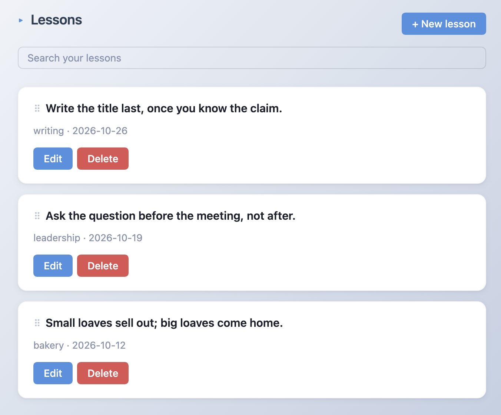
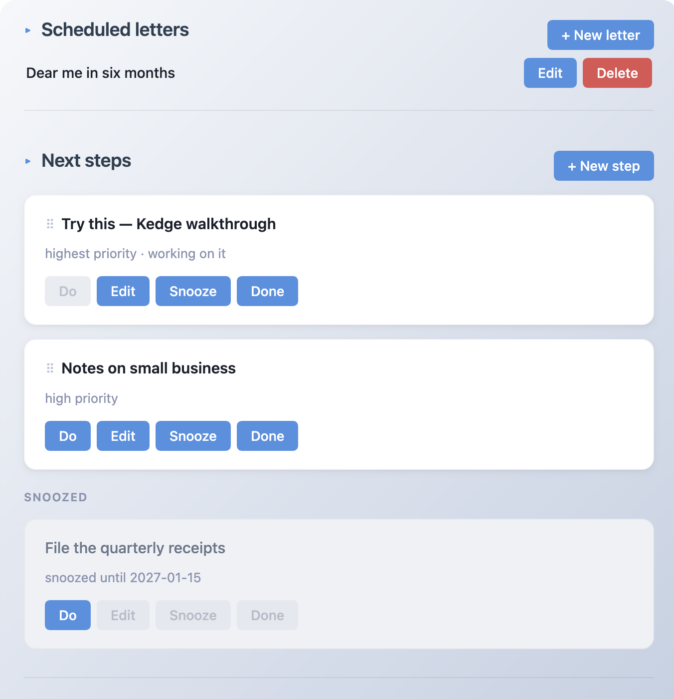

# Kedge

An Obsidian plugin for getting the next thing done. It keeps one next step in front of you, takes lessons you've already learned and writes them down, and holds letters you write to yourself to read later. All of it is plain markdown in your vault.


## Why this exists

I have ADHD. Knowing what to do was never the problem; starting was. A list of forty tasks doesn't tell you which one is next, and it doesn't care that you're not in the mood. So the dashboard shows one step and a Done button, and everything else waits its turn.

The other two parts point the same idea at different times. Lessons are things you already worked out, written down before they evaporate. Letters are notes you send forward, so future you remembers what this week actually felt like.

## Install

```bash
pnpm install
pnpm build
```

Copy `main.js`, `manifest.json` and `styles.css` into `<vault>/.obsidian/plugins/kedge/`, then enable Kedge in Settings → Community Plugins.

## Commands

| Command | What it does |
| --- | --- |
| Open dashboard (`Cmd+Shift+D`) | Opens it, reusing the tab if it's already open |
| Open dashboard in the sidebar | Puts it in the right sidebar, so it stays visible while you work |
| Write letter to future me (`Cmd+Shift+M`) | Title, the letter, and when it should come back |
| Create next step (`Cmd+Shift+N`) | Title and priority |
| Create lesson (`Cmd+Shift+L`) | One line, optional category |

Every command is also a button on the dashboard, and the shortcuts are printed under the title there, so you can live without the keyboard if you want.

Obsidian has no tab pinning. The sidebar is the next best thing: it stays open beside whatever note you're editing, and it comes back after a restart because Obsidian saves the layout.

## Using it

Priorities are words, not numbers: highest, high, medium, low, lowest. They're stored as 1 to 5 in the note. Drag a card by its ⠿ handle to set your own order, which is saved as an `order` field. Cards without one fall back to priority, or for lessons, newest first.

Edit and Delete sit on the card itself: a step's title and priority, a lesson's line and category. Deleting removes that note and nothing else.

The lessons list has a search box that filters as you type. `boring` finds "Ship the boring version first", and so does `shbv`, with the best match first. Clearing the box brings the full list back.



Snoozed steps drop into a grey group at the bottom of the list. Their Edit, Snooze and Done buttons are disabled, because a snoozed step isn't something you act on, it's something you parked. Do still works: it takes the step off snooze and marks it as the one you're on. When the snooze date passes, the step climbs back into the normal list on its own.



Do never opens a note. It sets `status: working` and clears the snooze. The note is where it always was, in the file explorer.

## Letters to your future self

You get a title, the letter, and when it should come back. There are quick picks for one month, six months and a year, or you can set an exact date, and a line under the field tells you what you picked in words before you seal it.

Scheduled letters are a compact list: one line each, title only, with Edit and Delete on the right. Hover a row for the return date and when you wrote it. Editing reopens the letter with its body, so you can fix a typo or move the date.

Arrived letters show up under "From past you" with Reply to past me, which appends a dated `## Reply` section to the letter note, plus Delete for when you're finished with it.

Opening the dashboard never rewrites your letters. A sealed letter whose date is today or earlier just shows up, so a day can bring one letter or none.

## Data model

Everything is a markdown note you can edit by hand:

- `Kedge/Letters/*.md` has `id`, `title`, `status` (sealed/delivered/opened), `seal_date`, `created_at`
- `Kedge/Next-Steps/*.md` has `id`, `title`, `status` (pending/working/snoozed/done), `priority` (1 to 5), `snooze_until`, `order`, `created_at`
- `Kedge/Lessons/*.md` has `id`, `claim`, `category`, `week`, `order`, `created_at`

## Develop

```bash
pnpm install        # obsidian, typescript, @types/node, esbuild, jest
pnpm build          # esbuild → main.js
pnpm dev            # watch mode
pnpm typecheck      # tsc --noEmit against the real obsidian.d.ts
pnpm test           # typecheck + jest (mocked Obsidian)
pnpm smoke          # live run in real Obsidian, scratch vault
```

`pnpm test` runs the typecheck and then the jest suite. It's fast and offline, and it runs against a hand-written Obsidian mock, which means it can't tell you whether Obsidian accepts a call or whether anything appears on screen. Every bug of that kind in this repo got past a green suite.

`pnpm smoke` covers that gap. It builds, makes a throwaway vault in `$TMPDIR`, installs the plugin into it, switches Obsidian over through the official `obsidian` CLI, and checks that the plugin loaded, its commands registered, `kedge:open-dashboard` ran, a `kedge-dashboard` view exists in the workspace, and `onload` created the three folders.

It needs Obsidian running and the CLI on `PATH`. Takes about five seconds, and it puts the vault registry back on the way out, so your notes stay untouched. `--keep` leaves the throwaway vault behind if you want to see it.

What it can't check is drag and drop, or anything visual. Those need your eyes, or `obsidian dev:cdp`.

Types come from the `obsidian` npm package, which lags the app itself. Run `obsidian version` when something looks off.
